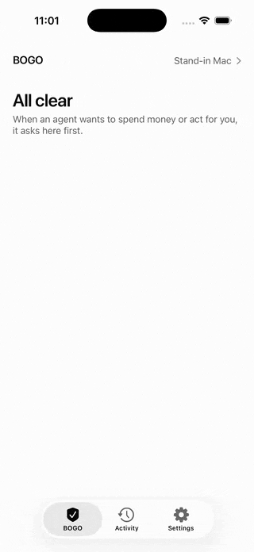
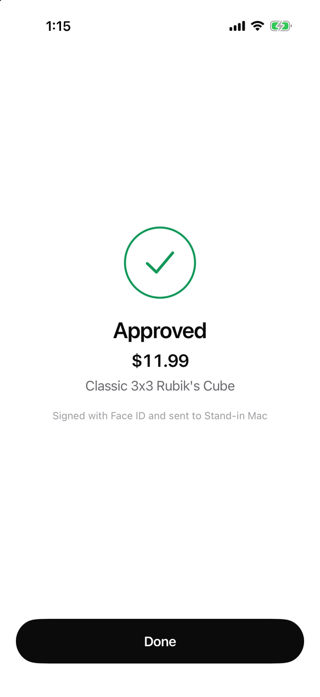

# BOGO

**Approve your AI agent's risky tool calls on your iPhone, one exact call at a time.**

[](https://testflight.apple.com/join/dQu75bv1)
[](https://github.com/JohanSardar/bogo/actions/workflows/ci.yml)
[](LICENSE)

An AI agent gets its power from MCP tools: tools that send email, move files
and spend money. Once it has a tool, it can call it with any arguments, at any
time, including when a web page has talked it into something.

BOGO sits between the agent and those tools, on your Mac. You choose which
tools are protected. A protected call waits until you see exactly what it will
do on your phone, slide to approve, and confirm with Face ID. Everything else
runs as you configured it, and a denied tool never runs.

## Get started in five minutes



1. **Install BOGO on your Mac** (Apple Silicon). No sudo; it goes into
   `~/.local/bin`:

   ```sh
   curl -fsSL https://bogo.eilmer.si:8443/install.sh | sh
   ```

2. **Get the iPhone app.** BOGO's approver is the BOGO tab of the Apple Bridge
   iPhone app:
   [join the TestFlight beta](https://testflight.apple.com/join/dQu75bv1).

3. **Run `bogo setup`.** It starts BOGO, pairs your iPhone, moves the MCP
   servers you already use in Claude Code, Claude Desktop or Cursor behind
   BOGO, and makes one protected test call for you to approve.

   ```sh
   bogo setup
   ```

The recording shows the last part: a protected call arrives, you check it,
slide, and Face ID approves it. [Install and set up](docs/setup.md) says what
each step changes on your Mac, and [recipes](docs/recipes/README.md) add Gmail,
GitHub, Slack, Stripe or a folder of files with a ready-made policy.

> **Status: early.** The TestFlight link doesn't admit testers yet: the first
> build hasn't been submitted to Apple's Beta App Review. Until then, build
> the app from [its repo](https://github.com/JohanSardar/apple-bridge-iphone#build-and-check).
> No session on a real iPhone (Face ID, App Attest and push on hardware) has
> been recorded yet. The recording above is the iOS Simulator with the app's
> built-in stand-in Mac. The Mac side, including the install and `bogo setup`,
> has been run end to end with a software test approver.
> [What is verified](docs/status.md) lists what has been checked.

<br clear="right">

<a id="quick-start-on-macos"></a>

### Try it without an iPhone

Build BOGO from source with the **software test approver**, which approves on
the Mac in place of the phone, and watch a protected call wait for you. It
signs without Face ID, so never use it to protect real actions.
[Build from source and try it](docs/build-from-source.md) has the steps.

### Why BOGO

- **You approve the exact call.** The phone shows the tool, its arguments,
  which agent asked and its justification. Your approval signs those exact bytes and
  runs that call once, only while the agent's session is still open.
- **The key never leaves your phone.** The approval key is made in the iPhone's
  Secure Enclave, and every approval needs Face ID.
- **Every decision is on the record.** BOGO writes every request and outcome to
  an append-only, hash-chained log. `bogo log verify` checks it.
- **The core is proved, and the rest is listed.** The code that decides whether
  a call may run is written in Lean and proved. [What is proved / What is
  assumed](docs/proved-and-assumed.md) says exactly where the proof stops.

This repo holds BOGO itself: the Mac daemon, the `bogo` CLI, the shim agents
connect through, the relay and the proofs. The iPhone approver is the BOGO tab
of the [Apple Bridge iPhone app](https://github.com/JohanSardar/apple-bridge-iphone).
[Which repo do I want?](#which-repo-do-i-want)

## See it work

<table>
  <tr>
    <td width="33%" valign="top"><b>1. The agent asks.</b> It calls a protected tool through BOGO. The call waits, and your iPhone gets a push.</td>
    <td width="33%" valign="top"><b>2. You see the exact call.</b> The Review card shows what will run, which agent asked, and its justification.</td>
    <td width="33%" valign="top"><b>3. You slide, then Face ID.</b> BOGO checks the signature and runs that one call. Deny, and it never runs.</td>
  </tr>
  <tr>
    <td><picture><source media="(prefers-color-scheme: dark)" srcset="assets/screenshots/home-dark.png"></picture></td>
    <td><picture><source media="(prefers-color-scheme: dark)" srcset="assets/screenshots/details-dark.png"></picture></td>
    <td><picture><source media="(prefers-color-scheme: dark)" srcset="assets/screenshots/approved-dark.png"></picture></td>
  </tr>
</table>

Screenshots are from the iPhone Simulator with the app's built-in demo request.

## More ways in

- **Read the install script first:** the short URL forwards to
  [`install.sh`](install.sh) in this repo
  (`https://raw.githubusercontent.com/JohanSardar/bogo/main/install.sh`). It
  checks the download's SHA-256 before installing. `BOGO_VERSION` pins a
  release, `BOGO_INSTALL_DIR` installs elsewhere, and running it again
  upgrades. [Releasing BOGO](docs/release.md) covers versions and signing.
- **Step by step instead of `bogo setup`:** [run BOGO on your
  Mac](docs/daemon.md), [add your iPhone](docs/add-your-iphone.md) and
  [connect an agent](docs/agents.md).
- **Build from source:** [build from source and try it](docs/build-from-source.md).

## How it works, and why it's safe

```
 agent ── MCP ──► bogo-shim ──► BOGO daemon (your Mac) ──► MCP servers (upstreams)
                                   │            ▲
                     encrypted     ▼            │   signed decision
                               BOGO relay ◄──► iPhone: BOGO tab, Face ID
```

1. Each agent gets its own name and token. BOGO treats every agent as
   untrusted, whatever it says about itself.
2. Every tool has a policy: **allow**, **approve** or **deny**, per tool or
   per action, and per agent if you like ([configuration](docs/configuration.md)).
3. A protected call becomes an approval request: the exact tool call, the
   agent's justification, a nonce, the session that asked and an expiry if the tool
   has one. BOGO sends
   it, end-to-end encrypted, through its relay to your registered approvers.
   The relay sees only ciphertext and routing data.
4. Your iPhone decodes the request, shows it on the Review card, and signs the
   exact bytes with its Secure Enclave key after you slide and pass Face ID.
5. BOGO's Lean core checks the signature, that the session is still open, any
   expiry, and that the approval is unused, at the last moment before it sends
   the call upstream.
   The call runs once. Every step goes into the hash-chained log.

The [threat model](docs/threat-model.md) lists what BOGO defends against and
what it assumes, and [SECURITY.md](SECURITY.md) says how to report a problem.

### What BOGO does not protect against

- **An agent that goes around MCP.** BOGO only controls calls that pass through
  it. An agent with a shell, a browser or its own credentials on your Mac can
  skip BOGO entirely. Run agents in the [reference sandbox](sandbox/README.md)
  so BOGO is their only way out.
- **Approving the wrong thing.** BOGO shows you exactly what will run, but it
  can't judge it for you. The agent's justification is its own words, and the
  Review card marks it "Not verified by BOGO".
- **The software test approver.** It exists for demos and tests, signs without
  Face ID, and anyone with your Mac account can use it. Production builds leave
  it out.
- **Effects BOGO can't see.** Once a call reaches an upstream, that service may
  act even if the result never comes back. BOGO reports such outcomes as
  unknown and never retries them on its own.

More in the [FAQ](docs/faq.md).

## Which repo do I want?

| Repo | What it is | Go there to |
|---|---|---|
| [JohanSardar/bogo](https://github.com/JohanSardar/bogo) | **BOGO**: the Mac daemon, CLI, shim and relay that put approval in front of an AI agent's MCP tools, plus the spec, proofs and docs | run BOGO, connect an agent, read how it works, report a BOGO bug |
| [JohanSardar/apple-bridge-iphone](https://github.com/JohanSardar/apple-bridge-iphone) | **Apple Bridge iPhone app**: Apple Bridge's iPhone companion, which also carries the BOGO tab, BOGO's iPhone approver | build or test the iPhone app, report a bug in the app |
| [JohanSardar/apple-bridge](https://github.com/JohanSardar/apple-bridge) | **Apple Bridge** for Mac: gives agents your Mac's Messages, Mail, Calendar and more through one local MCP server. Separate from BOGO | use Apple Bridge on your Mac |

BOGO and Apple Bridge are separate products that share only the iPhone app.
BOGO uses no Apple Bridge server, relay or key. Words like approver, relay and
Review card are defined once in the [glossary](GLOSSARY.md).

## What's in this repo

| Path | What |
|---|---|
| [`crates/bogo`](crates/bogo) | `bogo`, the owner CLI: init, start, stop, agents, approvers, tools, requests, the log |
| [`crates/bogo-daemon`](crates/bogo-daemon) | `bogo-daemon`, BOGO itself, which `bogo serve` and the LaunchAgent run |
| [`crates/bogo-shim`](crates/bogo-shim) | `bogo-shim`, the stdio bridge an MCP client starts to reach BOGO |
| [`crates/bogo-relay`](crates/bogo-relay), [`bogo-relay-proto`](crates/bogo-relay-proto) | `bogo-relay`, the mailbox that carries encrypted messages to approvers, and its wire format |
| [`lean/`](lean) | The decision core (`BogoCore`), its proofs (`BogoProofs`) and the test vectors it generates |
| [`crates/bogo-core-sys`](crates/bogo-core-sys), [`bogo-core`](crates/bogo-core), [`bogo-verify`](crates/bogo-verify) | Build the Lean core into the daemon and call it safely from Rust |
| [`crates/bogo-front`](crates/bogo-front), [`bogo-upstream`](crates/bogo-upstream), [`bogo-filter`](crates/bogo-filter) | The MCP server agents see, the connections to upstreams with the final check, and output filtering |
| [`crates/bogo-approver`](crates/bogo-approver), [`bogo-approver-iphone`](crates/bogo-approver-iphone), [`bogo-approver-soft`](crates/bogo-approver-soft), [`bogo-attest`](crates/bogo-attest), [`bogo-apns`](crates/bogo-apns) | Approvers: the hub, the iPhone route with App Attest and push, and the software test approver |
| [`crates/bogo-log`](crates/bogo-log), [`bogo-state`](crates/bogo-state), [`bogo-config`](crates/bogo-config), [`bogo-json`](crates/bogo-json) | The audit log, BOGO's private directory, `bogo.toml` parsing and the strict JSON parser |
| [`crates/bogo-e2e`](crates/bogo-e2e), [`bogo-standin`](crates/bogo-standin), [`bogo-bypass`](crates/bogo-bypass) | Test tools: end-to-end crypto, a stand-in Mac for phone tests, and the sandbox bypass suite |
| [`vectors/`](vectors) | Request bytes and JSON cases shared by the Lean core, Rust and the iPhone app |
| [`sandbox/`](sandbox) | The reference sandbox that leaves BOGO as an agent's only way out |
| [`deploy/relay/`](deploy/relay) | How the public relay is deployed |
| [`docs/`](docs/README.md) | User guides and how it works; the project's records are in [`docs/internal/`](docs/internal/README.md) |

## Docs and community

- **[Docs index](docs/README.md)**: install, use and run BOGO, and how it works.
- **[FAQ](docs/faq.md)** and **[what is verified](docs/status.md)**.
- **[Contributing](CONTRIBUTING.md)**, including how this project uses AI
  agents and what evidence a change needs.
- **[Security policy](SECURITY.md)**: report vulnerabilities privately, and
  what BOGO depends on.
- **[Code of Conduct](CODE_OF_CONDUCT.md)**.
- **[Changelog](CHANGELOG.md)**.
- BOGO bugs go to [this repo's issues](https://github.com/JohanSardar/bogo/issues/new/choose),
  even when they show up on the phone.

## License

[MIT](LICENSE). Created in [T3 Code](https://t3.codes).
