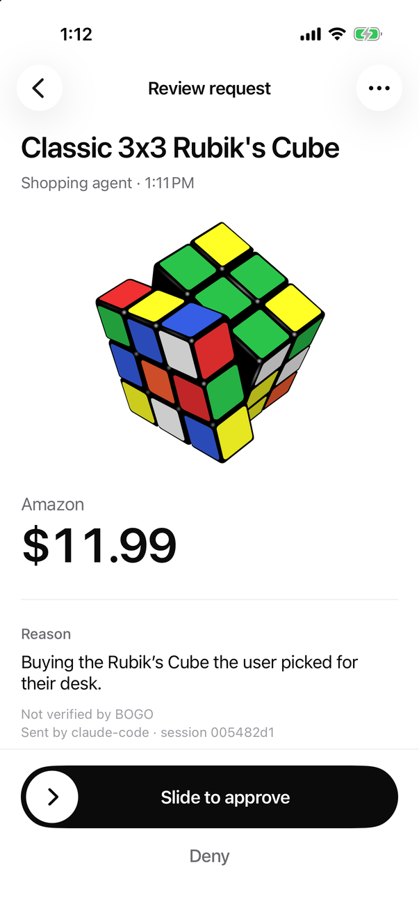
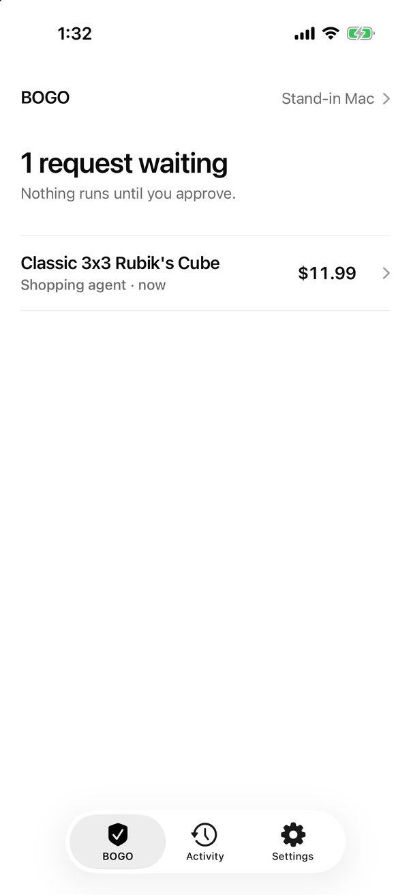
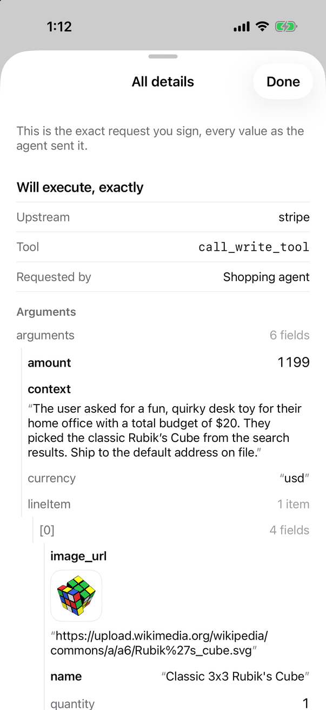

# BOGO

**Approve your AI agent's risky tool calls on your iPhone, one exact call at a time.**

[](https://testflight.apple.com/join/dQu75bv1)
[](https://github.com/JohanSardar/bogo/actions/workflows/ci.yml)
[](LICENSE)

<picture>
  <source media="(prefers-color-scheme: dark)" srcset="assets/screenshots/review-dark.png">
  
</picture>

An AI agent gets its power from MCP tools: tools that send email, move files
and spend money. Once it has a tool, it can call it with any arguments, at any
time, including when a web page has talked it into something.

BOGO sits between the agent and those tools, on your Mac. You choose which
tools are protected. A protected call waits until you see exactly what it will
do on your phone, slide to approve, and confirm with Face ID. Everything else
runs as you configured it, and a denied tool never runs.

This repo holds BOGO itself: the Mac daemon, the `bogo` CLI, the shim agents
connect through, the relay and the proofs. The iPhone approver is the BOGO tab
of the [Apple Bridge iPhone app](https://github.com/JohanSardar/apple-bridge-iphone).
[Which repo do I want?](#which-repo-do-i-want)

> **Status: early.** The Mac side works end to end with a software test
> approver, and the iPhone side works in the Simulator. A session on a real
> iPhone (Face ID, App Attest and push) has not been recorded yet. The
> TestFlight link admits testers only once Apple's Beta App Review passes the
> first build, which it hasn't yet. [What is verified](docs/status.md) lists
> what has been checked.

### Why BOGO

- **You approve the exact call.** The phone shows the tool, its arguments,
  which agent asked and its justification. Your approval signs those exact bytes and
  runs that call once, only while the agent's session is still open.
- **The key never leaves your phone.** The approval key is made in the iPhone's
  Secure Enclave, and every approval needs Face ID.
- **Every decision is on the record.** BOGO writes every request and outcome to
  an append-only, hash-chained log. `bogo log verify` checks it.
- **The core is proved, and the rest is listed.** The code that decides whether
  a call may run is written in Lean and proved. [What is proved / What is
  assumed](docs/proved-and-assumed.md) says exactly where the proof stops.

<br clear="right">

## See it work

<table>
  <tr>
    <td width="33%" valign="top"><b>1. The agent asks.</b> It calls a protected tool through BOGO. The call waits, and your iPhone gets a push.</td>
    <td width="33%" valign="top"><b>2. You see the exact call.</b> The Review card shows what will run, which agent asked, and its justification.</td>
    <td width="33%" valign="top"><b>3. You slide, then Face ID.</b> BOGO checks the signature and runs that one call. Deny, and it never runs.</td>
  </tr>
  <tr>
    <td><picture><source media="(prefers-color-scheme: dark)" srcset="assets/screenshots/home-dark.png"></picture></td>
    <td><picture><source media="(prefers-color-scheme: dark)" srcset="assets/screenshots/details-dark.png"></picture></td>
    <td><picture><source media="(prefers-color-scheme: dark)" srcset="assets/screenshots/approved-dark.png"></picture></td>
  </tr>
</table>

Screenshots are from the iPhone Simulator with the app's built-in demo request.

## Get it

- **Mac (Apple Silicon):** install with one command, no sudo, into
  `~/.local/bin`:

  ```sh
  curl -fsSL https://bogo.eilmer.si:8443/install.sh | sh
  ```

  The short URL forwards to
  `https://raw.githubusercontent.com/JohanSardar/bogo/main/install.sh`, which
  you can read first or run the same way. It checks the download's SHA-256
  before installing. Set `BOGO_VERSION` to pin a release or
  `BOGO_INSTALL_DIR` to install elsewhere, and run it again to upgrade.
  [Releasing BOGO](docs/release.md) covers versions and signing. To build from
  source instead, follow the [quick start](#quick-start-on-macos) below.
- **iPhone:** the BOGO tab is part of the Apple Bridge iPhone app.
  [Join the TestFlight beta](https://testflight.apple.com/join/dQu75bv1), or
  [build it from source](https://github.com/JohanSardar/apple-bridge-iphone#build-and-check).
  The first build is still waiting for Apple's Beta App Review; until it
  passes, the link says the beta isn't accepting testers. Then
  [add your iPhone](docs/add-your-iphone.md) to BOGO on your Mac.
- **Connect an agent:** [Claude Code and other MCP clients](docs/agents.md).

## Quick start on macOS

This runs BOGO on your Mac with a **software test approver** in place of the
phone, so you can watch a protected call wait for approval, without an iPhone.
The software test approver signs without Face ID: never use it to protect real
actions.

Prerequisites: Xcode Command Line Tools, [Rust via rustup](https://rustup.rs/),
[Lean via elan](https://github.com/leanprover/elan#installation), Node.js and
npm, Python 3, and an installed, signed-in
[Claude Code](https://code.claude.com/docs/en/setup) CLI (`claude`). The repo
pins Lean in `lean/lean-toolchain`. Put elan first on `PATH`, because some
Python installs ship an unrelated program called `lean`.

Run everything from this repo's root, in **one terminal**. The demo uses a
fresh private temporary directory and leaves `~/.bogo` alone. Port 18790 must
be free. No LaunchAgent is loaded.

```sh
export PATH="$HOME/.elan/bin:$PATH"
cargo build -p bogo -p bogo-daemon -p bogo-shim --features bogo/test-approvers
export BOGO_BIN="$PWD/target/debug/bogo"
export BOGO_SHIM="$PWD/target/debug/bogo-shim"
export BOGO_DEMO="$(mktemp -d /tmp/bogo-quickstart.XXXXXX)"
export BOGO_DEMO_HOME="$BOGO_DEMO/home"
umask 077
mkdir -p "$BOGO_DEMO/scratch" "$BOGO_DEMO/client"
"$BOGO_BIN" --home "$BOGO_DEMO_HOME" init
npm install --prefix "$BOGO_DEMO/upstream" --no-audit --no-fund \
  @modelcontextprotocol/server-filesystem@2.3.0
```

Configure a demo policy: at most four live requests per agent, file reads
allowed, file writes protected. Any tool not listed still needs approval. The
filesystem server can reach only the scratch directory.

```sh
cat > "$BOGO_DEMO_HOME/bogo.toml" <<'TOML'
version = 1
[server]
port = 18790
[defaults]
policy = "approve"
max_pending = 4
[tools.files__read_text_file]
policy = "allow"
[tools.files__write_file]
policy = "approve"
justification = "required"
TOML
"$BOGO_BIN" --home "$BOGO_DEMO_HOME" upstream add files -- \
  "$(command -v node)" \
  "$BOGO_DEMO/upstream/node_modules/@modelcontextprotocol/server-filesystem/dist/index.js" \
  "$BOGO_DEMO/scratch"
"$BOGO_BIN" --home "$BOGO_DEMO_HOME" serve > "$BOGO_DEMO/daemon.log" 2>&1 &
BOGO_DAEMON_PID=$!
```

Check the daemon, register the software test approver and a named agent, and
write the agent's MCP config. `status` waits for startup and should show
`running: true` and `upstreams: {files: true}`; if startup failed, read
`$BOGO_DEMO/daemon.log`. The agent's token goes into an environment variable,
never into the config file or the terminal.

```sh
until "$BOGO_BIN" --home "$BOGO_DEMO_HOME" status | grep -q '"running": true'
do kill -0 "$BOGO_DAEMON_PID" || break; sleep 1; done
"$BOGO_BIN" --home "$BOGO_DEMO_HOME" status
"$BOGO_BIN" --home "$BOGO_DEMO_HOME" approver add 'Demo approver' --kind soft
export BOGO_AGENT_TOKEN="$("$BOGO_BIN" --home "$BOGO_DEMO_HOME" agent add 'Demo agent' \
  | python3 -c 'import json,sys; print(json.load(sys.stdin)["token"])')"
export BOGO_URL=http://127.0.0.1:18790/mcp
python3 - <<'PY'
import json, os
from pathlib import Path
p = Path(os.environ['BOGO_DEMO']) / 'client' / 'mcp.json'
p.write_text(json.dumps({'mcpServers': {'bogo': {'command': os.environ['BOGO_SHIM']}}}))
PY
"$BOGO_BIN" --home "$BOGO_DEMO_HOME" tools
```

Ask Claude to read a file and then write one. It runs in the background from
the empty client directory, with only BOGO's tools enabled. That restriction
keeps the demo reproducible; it is not a sandbox.

```sh
printf 'Hello from BOGO\n' > "$BOGO_DEMO/scratch/hello.txt"
(
  cd "$BOGO_DEMO/client"
  claude -p "Use files__read_text_file to read $BOGO_DEMO/scratch/hello.txt. Then use files__write_file to write exactly BOGO APPROVED to $BOGO_DEMO/scratch/approved.txt, with justification 'Quick start protected write'. Report both tool results." \
    --mcp-config "$BOGO_DEMO/client/mcp.json" --strict-mcp-config \
    --tools '' --allowedTools 'mcp__bogo__*' --permission-mode dontAsk \
    < /dev/null > "$BOGO_DEMO/claude.out" 2>&1
) &
BOGO_CLAUDE_PID=$!
until BOGO_REQUEST_ID="$("$BOGO_BIN" --home "$BOGO_DEMO_HOME" request list \
  | python3 -c 'import json,sys; print(json.load(sys.stdin)[0]["id"])' 2>/dev/null)"
do kill -0 "$BOGO_CLAUDE_PID" || break; sleep 2; done
```

That waits until the write is pending and keeps its request ID. The read
already ran. The write is waiting for you. Look at what it will do, and see
that the file doesn't exist yet:

```sh
"$BOGO_BIN" --home "$BOGO_DEMO_HOME" log search files__write_file
test ! -e "$BOGO_DEMO/scratch/approved.txt" && printf 'Not written before approval\n'
```

If the logged `agent_name`, `tool` and `arguments` are the demo write, approve
it:

```sh
"$BOGO_BIN" --home "$BOGO_DEMO_HOME" soft 'Demo approver' "$BOGO_REQUEST_ID"
wait "$BOGO_CLAUDE_PID"
cat "$BOGO_DEMO/claude.out"
cat "$BOGO_DEMO/scratch/approved.txt"
"$BOGO_BIN" --home "$BOGO_DEMO_HOME" log verify
```

Expect `decision recorded`, Claude's report of both real tool results, the file
content `BOGO APPROVED`, and `chain intact` with one counted approval. Stop the
daemon and check its log once more:

```sh
kill -TERM "$BOGO_DAEMON_PID"
wait "$BOGO_DAEMON_PID"
"$BOGO_BIN" --home "$BOGO_DEMO_HOME" log verify
unset BOGO_AGENT_TOKEN
```

The demo directory holds the call arguments, the log and the software key. Keep
it private, and delete that directory when you're done. To run BOGO for real,
see [Run BOGO on your Mac](docs/daemon.md).

## How it works, and why it's safe

```
 agent ── MCP ──► bogo-shim ──► BOGO daemon (your Mac) ──► MCP servers (upstreams)
                                   │            ▲
                     encrypted     ▼            │   signed decision
                               BOGO relay ◄──► iPhone: BOGO tab, Face ID
```

1. Each agent gets its own name and token. BOGO treats every agent as
   untrusted, whatever it says about itself.
2. Every tool has a policy: **allow**, **approve** or **deny**, per tool or
   per action, and per agent if you like ([configuration](docs/configuration.md)).
3. A protected call becomes an approval request: the exact tool call, the
   agent's justification, a nonce, the session that asked and an expiry if the tool
   has one. BOGO sends
   it, end-to-end encrypted, through its relay to your registered approvers.
   The relay sees only ciphertext and routing data.
4. Your iPhone decodes the request, shows it on the Review card, and signs the
   exact bytes with its Secure Enclave key after you slide and pass Face ID.
5. BOGO's Lean core checks the signature, that the session is still open, any
   expiry, and that the approval is unused, at the last moment before it sends
   the call upstream.
   The call runs once. Every step goes into the hash-chained log.

The [threat model](docs/threat-model.md) lists what BOGO defends against and
what it assumes, and [SECURITY.md](SECURITY.md) says how to report a problem.

### What BOGO does not protect against

- **An agent that goes around MCP.** BOGO only controls calls that pass through
  it. An agent with a shell, a browser or its own credentials on your Mac can
  skip BOGO entirely. Run agents in the [reference sandbox](sandbox/README.md)
  so BOGO is their only way out.
- **Approving the wrong thing.** BOGO shows you exactly what will run, but it
  can't judge it for you. The agent's justification is its own words, and the
  Review card marks it "Not verified by BOGO".
- **The software test approver.** It exists for demos and tests, signs without
  Face ID, and anyone with your Mac account can use it. Production builds leave
  it out.
- **Effects BOGO can't see.** Once a call reaches an upstream, that service may
  act even if the result never comes back. BOGO reports such outcomes as
  unknown and never retries them on its own.

More in the [FAQ](docs/faq.md).

## Which repo do I want?

| Repo | What it is | Go there to |
|---|---|---|
| [JohanSardar/bogo](https://github.com/JohanSardar/bogo) | **BOGO**: the Mac daemon, CLI, shim and relay that put approval in front of an AI agent's MCP tools, plus the spec, proofs and docs | run BOGO, connect an agent, read how it works, report a BOGO bug |
| [JohanSardar/apple-bridge-iphone](https://github.com/JohanSardar/apple-bridge-iphone) | **Apple Bridge iPhone app**: Apple Bridge's iPhone companion, which also carries the BOGO tab, BOGO's iPhone approver | build or test the iPhone app, report a bug in the app |
| [JohanSardar/apple-bridge](https://github.com/JohanSardar/apple-bridge) | **Apple Bridge** for Mac: gives agents your Mac's Messages, Mail, Calendar and more through one local MCP server. Separate from BOGO | use Apple Bridge on your Mac |

BOGO and Apple Bridge are separate products that share only the iPhone app.
BOGO uses no Apple Bridge server, relay or key. Words like approver, relay and
Review card are defined once in the [glossary](GLOSSARY.md).

## What's in this repo

| Path | What |
|---|---|
| [`crates/bogo`](crates/bogo) | `bogo`, the owner CLI: init, start, stop, agents, approvers, tools, requests, the log |
| [`crates/bogo-daemon`](crates/bogo-daemon) | `bogo-daemon`, BOGO itself, which `bogo serve` and the LaunchAgent run |
| [`crates/bogo-shim`](crates/bogo-shim) | `bogo-shim`, the stdio bridge an MCP client starts to reach BOGO |
| [`crates/bogo-relay`](crates/bogo-relay), [`bogo-relay-proto`](crates/bogo-relay-proto) | `bogo-relay`, the mailbox that carries encrypted messages to approvers, and its wire format |
| [`lean/`](lean) | The decision core (`BogoCore`), its proofs (`BogoProofs`) and the test vectors it generates |
| [`crates/bogo-core-sys`](crates/bogo-core-sys), [`bogo-core`](crates/bogo-core), [`bogo-verify`](crates/bogo-verify) | Build the Lean core into the daemon and call it safely from Rust |
| [`crates/bogo-front`](crates/bogo-front), [`bogo-upstream`](crates/bogo-upstream), [`bogo-filter`](crates/bogo-filter) | The MCP server agents see, the connections to upstreams with the final check, and output filtering |
| [`crates/bogo-approver`](crates/bogo-approver), [`bogo-approver-iphone`](crates/bogo-approver-iphone), [`bogo-approver-soft`](crates/bogo-approver-soft), [`bogo-attest`](crates/bogo-attest), [`bogo-apns`](crates/bogo-apns) | Approvers: the hub, the iPhone route with App Attest and push, and the software test approver |
| [`crates/bogo-log`](crates/bogo-log), [`bogo-state`](crates/bogo-state), [`bogo-config`](crates/bogo-config), [`bogo-json`](crates/bogo-json) | The audit log, BOGO's private directory, `bogo.toml` parsing and the strict JSON parser |
| [`crates/bogo-e2e`](crates/bogo-e2e), [`bogo-standin`](crates/bogo-standin), [`bogo-bypass`](crates/bogo-bypass) | Test tools: end-to-end crypto, a stand-in Mac for phone tests, and the sandbox bypass suite |
| [`vectors/`](vectors) | Request bytes and JSON cases shared by the Lean core, Rust and the iPhone app |
| [`sandbox/`](sandbox) | The reference sandbox that leaves BOGO as an agent's only way out |
| [`deploy/relay/`](deploy/relay) | How the public relay is deployed |
| [`docs/`](docs/README.md) | User guides, how it works, and the project's internal records |

## Docs and community

- **[Docs index](docs/README.md)**: use BOGO, run it, and how it works.
- **[FAQ](docs/faq.md)** and **[what is verified](docs/status.md)**.
- **[Contributing](CONTRIBUTING.md)**, including how this project uses AI
  agents and what evidence a change needs.
- **[Security policy](SECURITY.md)**: report vulnerabilities privately.
- **[Changelog](CHANGELOG.md)**.
- BOGO bugs go to [this repo's issues](https://github.com/JohanSardar/bogo/issues/new/choose),
  even when they show up on the phone.

## License

[MIT](LICENSE). Created in [T3 Code](https://t3.codes).
